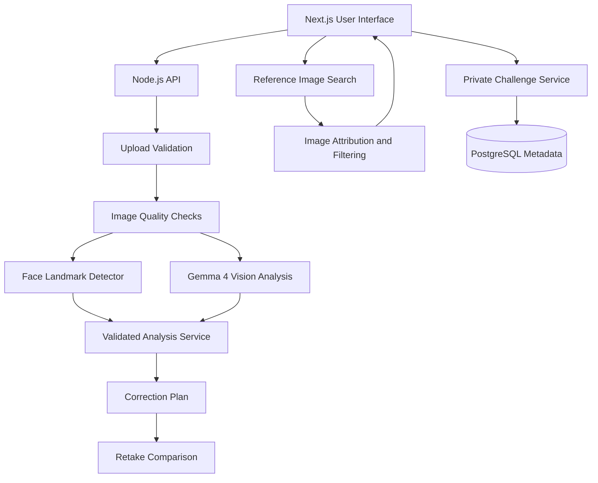

# Mog Mirror
## Final Hackathon Architecture & Implementation Specification

**Tagline:** Outdo your last photo, not another person.

**Product vision:** Mog Mirror is an open-source, Gemma 4-powered visual coaching application that helps users improve photo presentation through image analysis, alignment guidance, authorized reference-image discovery, and friendly photography challenges.

## 1. Product objectives

### Primary objectives

1. Analyze photographs using multimodal Gemma 4 reasoning.
2. Provide practical corrections for camera positioning, head tilt, framing, lighting, and background.
3. Display facial landmarks and geometric symmetry information without ranking attractiveness.
4. Find relevant public reference photographs through an image-search provider.
5. Compare a user's original photograph with a retake.
6. Support private friend challenges for personal improvement and photography quality.
7. Minimize image retention and make consent explicit.

### Non-goals for the MVP

- Attractiveness or facial-beauty scores.
- Medical, psychological, or personality assessments.
- Automatic facial reconstruction or feature modification.
- Facial identity recognition or face matching between people.
- Scraping arbitrary websites or bypassing image access restrictions.
- Public photo leaderboards or unrestricted image sharing.
- Training a custom model during the hackathon.

## 2. Product modules

### Module A — AI Photo Coach

**Input:** One user-selected photograph and a selected photography goal.

Supported goals:
- Professional profile.
- Social media portrait.
- Creator thumbnail.
- Casual portrait.

**Processing:**
1. Validate the uploaded file.
2. Extract image dimensions and basic quality measurements.
3. Send the image and goal to Gemma 4.
4. Validate the returned structured response.
5. Display evidence-backed observations and prioritized corrections.

**Output:**
- Three recommended corrections.
- A short explanation of each observation.
- Confidence or uncertainty indicators.
- A practical retake plan.

### Module B — Alignment and Symmetry

Use a facial-landmark detector for geometric measurements. Do not ask a language model to estimate precise landmark coordinates from prose.

**Measurements:**
- Approximate head tilt.
- Face position within the image.
- Landmark visibility.
- Left-right landmark displacement relative to a defined facial centerline.
- Suitability of the crop for the selected use case.

**Correction actions:**
- Rotate the photograph slightly.
- Adjust crop boundaries.
- Show a centerline or alignment guide.
- Suggest moving the camera toward eye level.
- Suggest retaking the photograph with a more frontal camera position when appropriate.

All image transformations should be reversible and previewable.

**Important limitation:** A photograph is a 2D projection of a 3D face. Perspective, head rotation, expression, occlusion, and detector error can affect apparent symmetry. The application must describe measurements as image-dependent geometric observations, not objective measures of beauty or health.

### Module C — Public Reference Explorer

Find reference images for the user's chosen style, such as:
- Professional headshot.
- Soft window lighting.
- Centered portrait.
- Minimal background.
- Creator portrait composition.

**Workflow:**
1. Convert the selected goal into a focused image-search query.
2. Search using an authorized image-search provider.
3. Retrieve a small number of candidate results.
4. Filter unsupported formats and unavailable URLs.
5. Display thumbnails, attribution, source pages, and licensing information where available.
6. Let the user select a reference for composition coaching.
7. Compare controllable photographic properties against the reference.

The system should compare framing, subject placement, lighting direction, and background complexity—not declare that one person's face is superior to another's.

A public URL does not automatically grant permission to download, transform, or redistribute an image. Respect provider terms, copyright, robots policies where applicable, and image licensing. If reuse rights are unclear, display a link to the original source rather than copying the image into persistent storage.

**Provider architecture:** Define an `ImageSearchProvider` interface so the implementation can use a permitted provider such as an image-search API without coupling the entire application to one vendor. Do not assume that Gemma's hosted API includes general-purpose web image search.

### Module D — Retake Intelligence

This is the flagship differentiator.

**Workflow:**
1. Analyze the original photograph.
2. Generate a prioritized action plan.
3. Let the user take or upload a second photograph.
4. Analyze the second photograph using the same criteria.
5. Compare measurements and model observations.
6. Show what changed, what appears improved, and what remains uncertain.

The comparison must use consistent criteria for both images.

Example:

- Original: face partially shadowed; background visually busy.
- Retake: more even illumination; fewer competing background elements.
- Remaining suggestion: adjust the crop to provide more space above the head.

Do not infer improvement solely from the model's general impression. Use deterministic image measurements where appropriate and present uncertain visual judgments as such.

### Module E — Friend Challenges

Support two challenge types.

**Challenge 1: Personal improvement**

Each participant starts with an original photograph and attempts to improve their own result. The system evaluates change relative to that participant's baseline.

**Challenge 2: Photography quality**

Participants follow the same brief, such as creating a well-lit professional headshot against a simple background.

Suggested scoring framework:

| Criterion | Weight |
|---|---:|
| Lighting and exposure | 30 |
| Framing and composition | 30 |
| Background and subject clarity | 25 |
| Completion of the photography brief | 15 |
| Total | 100 |

These weights are initial design choices, not scientifically validated measures. Implement deterministic scoring wherever possible, calibrate it against sample images, and label subjective or uncertain assessments.

**Challenge rules:**
- Private room codes.
- Explicit participant consent.
- Separate consent for submitting images to AI processing.
- Participant-controlled visibility.
- Room expiration and deletion.
- No attractiveness-based scoring.
- No facial identity recognition.
- No public leaderboard by default.

Use a fixed rubric for the photography-quality challenge so that one participant is not evaluated under a different standard from another.

## 3. Technical architecture

### Recommended stack

| Layer | Technology |
|---|---|
| Frontend | Next.js, React, TypeScript |
| Backend | Node.js with Next.js route handlers |
| AI | Gemma 4 through a supported inference route |
| Computer vision | MediaPipe Face Landmarker or a comparable maintained landmark detector |
| Image processing | Sharp |
| Validation | Zod |
| Database | PostgreSQL for rooms and challenge metadata |
| Image storage | Ephemeral memory or temporary storage for the MVP |
| Image search | A permitted third-party image-search API |
| Testing | Vitest and Playwright |
| Deployment | A Node-compatible hosting platform with server-side secrets |

Do not introduce a separate Python microservice unless the chosen computer-vision library or local inference environment requires it.

### Architecture diagram



The diagram separates deterministic image processing from model interpretation. The reference-image search and challenge service are separate workflows, not additional tasks that Gemma must execute on every photo.

## 4. Gemma 4 strategy

### Model selection

Use a provider abstraction:

```text
PhotoAnalysisProvider
  ├── LocalGemmaProvider
  └── HostedGemmaProvider
```

Google's documentation identifies `gemma-4-26b-a4b-it` and `gemma-4-31b-it` as models available through the hosted Gemini API. Smaller Gemma 4 variants are available for supported local inference environments.

For the hackathon:
- Prefer a locally deployed E4B variant if suitable hardware and a tested inference runtime are available.
- Otherwise, evaluate the hosted `gemma-4-26b-a4b-it` model first.
- Benchmark a larger model only if the smaller or cheaper configuration fails your evaluation criteria.

Do not hardcode an unverified model identifier. Confirm availability and image-input support in the actual deployment environment.

### What Gemma should do

Gemma is responsible for:
- Interpreting the image in the context of the user's selected goal.
- Explaining visible presentation issues.
- Combining computer-vision measurements with contextual observations.
- Generating practical, prioritized recommendations.
- Expressing uncertainty when an image does not provide sufficient evidence.

Gemma should not be responsible for:
- Precise landmark coordinate detection.
- Pixel-level image rotation or cropping.
- Calculating challenge totals.
- Enforcing consent and authorization.
- Validating upload size or image file formats.
- Fetching arbitrary internet resources without a controlled provider.
- Making unsupported claims about a person's attractiveness or identity.

### Efficiency strategy

1. Resize and normalize images before analysis while retaining enough detail for the task.
2. Avoid sending the original image multiple times during a single workflow.
3. Cache non-sensitive metadata where useful, but do not retain image-derived records unnecessarily.
4. Reuse deterministic landmark and image-quality results.
5. Use one multimodal request for the core photo-coaching result when possible.
6. Request structured output and validate it server-side.
7. Apply request timeouts, concurrency limits, and rate limits.
8. Benchmark latency, token usage, and correction quality before selecting a production model.

Avoid a multi-agent architecture for the MVP. Separate providers and deterministic services are easier to test and debug than a collection of autonomous agents.

## 5. API specification

All endpoints should be versioned under `/api/v1`.

### `POST /api/v1/photo/analyze`

**Purpose:** Analyze a photograph for the selected goal.

Request: `multipart/form-data`

```json
{
  "goal": "professional_profile",
  "consentConfirmed": true
}
```

The actual image is supplied as a multipart file field named `image`.

Response:

```json
{
  "analysisId": "analysis_123",
  "goal": "professional_profile",
  "observations": [
    {
      "category": "lighting",
      "evidence": "The face is unevenly illuminated",
      "confidence": "medium",
      "recommendation": "Face a window for softer, more even light"
    }
  ],
  "retakePlan": [
    "Move toward a window",
    "Simplify the background",
    "Keep the camera near eye level"
  ],
  "limitations": [
    "Observations depend on the image and may be uncertain"
  ]
}
```

The identifiers and response values above are illustrative.

### `POST /api/v1/photo/align`

**Purpose:** Generate geometric alignment information and suggested image corrections.

Request:

```json
{
  "analysisId": "analysis_123",
  "operations": [
    "alignment_overlay",
    "crop_suggestion",
    "rotation_suggestion"
  ]
}
```

Response:

```json
{
  "alignment": {
    "headTiltDegrees": 2.1,
    "measurementReliable": true
  },
  "suggestedCorrections": {
    "rotationDegrees": -2.1,
    "crop": {
      "x": 40,
      "y": 30,
      "width": 800,
      "height": 900
    }
  }
}
```

The numbers are examples only. Use the detector's actual output, validate coordinate bounds, and distinguish head tilt from the correction required to rotate the image.

### `POST /api/v1/photo/compare`

**Purpose:** Compare an original photograph and a retake.

Request:

```json
{
  "originalAnalysisId": "analysis_123",
  "retakeAnalysisId": "analysis_456",
  "goal": "professional_profile"
}
```

Response:

```json
{
  "comparison": [
    {
      "category": "lighting",
      "status": "improved",
      "explanation": "Illumination appears more even"
    },
    {
      "category": "background",
      "status": "unchanged",
      "explanation": "Several distracting objects remain visible"
    }
  ],
  "nextAction": "Try a simpler background"
}
```

The server must verify that both analyses belong to the authorized user or challenge. A client must never be allowed to compare arbitrary analysis identifiers belonging to other participants.

### `GET /api/v1/references`

**Purpose:** Retrieve relevant reference photographs.

Parameters:
- `goal`
- `style`
- `page`, if supported by the provider.

Response:

```json
{
  "items": [
    {
      "title": "Example professional portrait",
      "thumbnailUrl": "https://provider.example/thumbnail",
      "sourceUrl": "https://source.example/portrait",
      "creator": "Example Creator",
      "license": null
    }
  ]
}
```

The URLs are placeholders. Real values must come from the selected provider. A missing license must be represented as unknown, not treated as permission.

### `POST /api/v1/challenges`

**Purpose:** Create a private photography challenge.

Request:

```json
{
  "type": "personal_improvement",
  "goal": "professional_profile",
  "visibility": "private",
  "expiresInHours": 24
}
```

Response:

```json
{
  "challengeId": "challenge_123",
  "roomCode": "AB7K9Q",
  "expiresAt": "2026-10-28T20:00:00Z"
}
```

The expiry is an illustrative value. Generate room codes securely and enforce expiration on the server.

### `POST /api/v1/challenges/:id/submit`

**Purpose:** Submit a participant's photo and relevant analysis for an active challenge.

The server must:
- Verify room membership.
- Verify the challenge has not expired.
- Check participant consent.
- Enforce file and request limits.
- Evaluate only the challenge's defined criteria.
- Store only the minimum necessary metadata.
- Prevent unauthorized access to other participants' images.

## 6. Data schemas

Use Zod for runtime validation of requests, responses, environment configuration, and model output.

### Photo goal

```typescript
type PhotoGoal =
  | "professional_profile"
  | "social_portrait"
  | "creator_thumbnail"
  | "casual_portrait";
```

### Observation

```typescript
type Observation = {
  category:
    | "lighting"
    | "framing"
    | "background"
    | "expression_visibility"
    | "alignment"
    | "image_quality";

  evidence: string;

  confidence: "high" | "medium" | "low";

  recommendation: string;
};
```

Do not expose unsupported categories simply because the model generates them. The server must reject invalid category values and excessive output.

### Analysis result

```typescript
type PhotoAnalysis = {
  analysisId: string;
  goal: PhotoGoal;
  observations: Observation[];
  retakePlan: string[];
  limitations: string[];
};
```

Additional schema constraints:
- Limit the number of observations.
- Limit string lengths.
- Require at least one actionable recommendation when analysis succeeds.
- Require an explicit limitation when the model cannot reliably assess the image.
- Reject malformed JSON and unsupported fields.
- Never trust model-generated identifiers, URLs, authorization claims, or scoring totals.

## 7. Privacy and security

### Image handling

For the MVP:
- Validate actual file contents, not just filename extensions.
- Permit only supported raster formats.
- Set strict upload-size and pixel-dimension limits.
- Reject corrupt or unsupported files.
- Process uploads in memory when practical.
- Avoid writing photographs to application logs.
- Avoid persistent storage unless a feature genuinely requires it.
- Remove temporary files after processing.
- Document that images sent to a hosted model are processed by that provider under its applicable terms.

### User consent

Require an explicit confirmation before submitting a photograph for AI analysis.

The consent statement must explain:
- What image will be analyzed.
- Why it is being processed.
- Whether a third-party provider receives it.
- Whether any image or derived information is retained.
- How to leave a challenge and request deletion of stored data.

A checkbox is not proof that the user owns the photograph. Do not claim that the application verifies ownership or permission.

### Security controls

- Keep API keys in server-side environment variables.
- Never expose secret keys in frontend bundles.
- Rate-limit image-analysis and challenge endpoints.
- Use secure, unpredictable session and room tokens.
- Validate all request bodies.
- Prevent unauthorized analysis-ID access.
- Escape user-generated text.
- Avoid unrestricted server-side URL fetching.
- Protect image retrieval against SSRF, unsafe redirects, and private-network addresses.
- Do not execute arbitrary actions suggested by the model.
- Set appropriate response and image-serving headers.

### Challenge data

Store only necessary metadata, such as:
- Challenge identifier.
- Participant identifier.
- Challenge type.
- Submission timestamp.
- Rubric results.
- Expiration time.

Do not store biometric templates, facial identity embeddings, or facial recognition records.

## 8. Error handling

The API should return consistent error responses:

```json
{
  "error": {
    "code": "INVALID_IMAGE",
    "message": "Upload a supported image within the permitted size limit."
  }
}
```

Handle at least these cases:
- Missing image.
- Unsupported format.
- Excessive file size or pixel dimensions.
- Invalid consent.
- Face not detected.
- Face landmarks unreliable.
- Model timeout.
- Model rate limit or unavailable service.
- Malformed model response.
- Invalid image-search provider response.
- Expired challenge.
- Unauthorized participant.
- Comparison analysis missing or inaccessible.

If the model fails, do not silently replace its response with fabricated AI advice. Provide a clear error or offer a deterministic image-quality fallback that is labelled as such.

## 9. Testing strategy

### Unit tests

- File and MIME-type validation.
- Image dimension checks.
- Response-schema validation.
- Rotation and crop coordinate bounds.
- Challenge scoring calculations.
- Challenge expiration.
- Authorization rules.
- Image-search URL validation.

### Integration tests

- A real image reaches the configured Gemma provider.
- The model returns a valid structured response.
- Malformed output is rejected.
- The comparison uses the same criteria for both images.
- Image-search results preserve their source URLs and attribution.
- Challenge submissions are visible only to authorized participants.
- API failure does not leak image content or secrets.

### Evaluation dataset

Use a small, consented dataset with variation in:
- Lighting conditions.
- Head orientation.
- Background complexity.
- Face visibility.
- Glasses and partial occlusion.
- Different skin tones.
- Image resolution.
- Camera distance.

Evaluate:
- Observation relevance.
- Recommendation usefulness.
- Unsupported visual claims.
- Landmark detection failures.
- Response validity.
- Latency and failure rate.
- Privacy and access-control behavior.

Do not claim fairness, accuracy, or general reliability from a handful of demo photographs. Report the test conditions and known limitations.

### End-to-end acceptance criteria

The MVP is ready for judging when:

1. A user can upload a valid photograph and select a goal.
2. A real Gemma 4 inference produces a validated analysis.
3. The interface displays useful recommendations.
4. Alignment guidance and a crop preview work.
5. A retake can be compared against the original.
6. Reference-image search returns attributable results from the chosen provider.
7. Two authorized participants can complete a private challenge.
8. Invalid requests and API failures are handled safely.
9. No unnecessary image retention occurs.
10. The demo can be reproduced from the README using documented configuration.

## 10. Implementation plan

### Phase 1 — Core photo coaching

**Deliverables**
- Working Next.js application.
- Upload and goal selection.
- Gemma 4 image-analysis integration.
- Validated output schema.
- Results UI and error handling.

**Exit criterion:** One complete, repeatable real-model analysis.

### Phase 2 — Alignment and retake comparison

**Deliverables**
- Face landmark detection.
- Alignment overlay.
- Crop and rotation suggestions.
- Before-and-after comparison.

**Exit criterion:** A user can apply a suggestion and see the relevant visual change.

### Phase 3 — Reference discovery

**Deliverables**
- Image-search provider integration.
- Query generation.
- Attribution and source links.
- Reference-based composition guidance.

**Exit criterion:** Users can discover a permitted reference and receive useful composition advice.

### Phase 4 — Private challenges

**Deliverables**
- Room creation and joining.
- Two challenge types.
- Server-side scoring.
- Membership checks and expiration.
- Minimal challenge metadata.

**Exit criterion:** Two users can complete a challenge without unauthorized access to each other's data.

### Phase 5 — Submission readiness

**Deliverables**
- Automated tests.
- Error-state polish.
- Architecture diagram.
- Setup instructions.
- License and contribution guide.
- Recorded fallback demo.

**Exit criterion:** Another developer can reproduce the core workflow from the repository documentation.

## 11. What to prioritize if time is limited

For a two-day build, prioritize:
1. Real Gemma 4 image analysis.
2. Structured validation and safe upload handling.
3. Alignment overlay and correction guidance.
4. Retake comparison.
5. One successful reference-image search.
6. A minimal private challenge workflow only if the first five are stable.

If the deadline is only a few hours away, defer the database-backed challenge system and implement a controlled, temporary two-person demo instead.

Do not sacrifice working inference, test coverage, or consent controls to advertise a larger feature count.

## 12. Hackathon demonstration

**Opening:** "Mog Mirror doesn't tell you whether you beat another person's face. It helps you improve the photo you actually took."

**Demo sequence:**
1. Upload a consented portrait and choose a professional-profile goal.
2. Show the actual Gemma 4 analysis and evidence-backed corrections.
3. Display the alignment overlay and apply a suggested crop or rotation.
4. Upload a retake and show the observable changes.
5. Find a reference photograph and explain its composition.
6. Invite a friend into a private photography challenge.
7. Explain the hybrid AI architecture and demonstrate the repository's reproducible setup.

**Closing message:** "Mog Mirror turns multimodal AI from a one-shot opinion generator into a practical, measurable photo-improvement workflow."

## 13. Definition of success

The project succeeds when the core workflow is reliable, the recommendations are useful, the model's role is technically justified, the reference images are handled responsibly, and the repository is reproducible.

The objective is not to maximize the number of features. It is to demonstrate one coherent system that uses Gemma 4 for visual reasoning, conventional computer vision for measurements, and application code for corrections, privacy, and collaboration.
